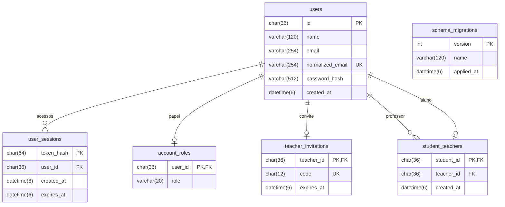
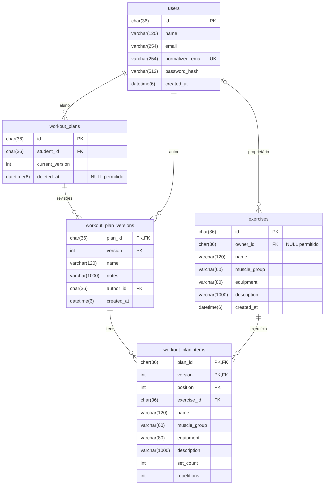
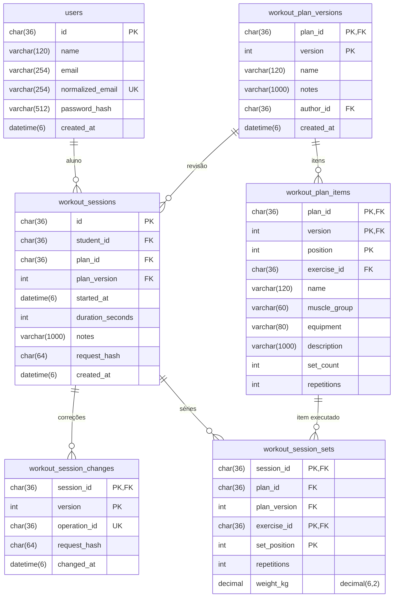

# Modelo do banco de dados Workoutly

Esquema MySQL 9, consultado em 21/10/2026: 13 tabelas, 69 colunas e 16 chaves estrangeiras. A representação segue as restrições do banco; regras adicionais do aplicativo estão anotadas. Não contém dados de usuários.

[Abrir o diagrama visual](workoutly-banco.html)

## Cardinalidades e decisões

- `1`: obrigatório; `0..1`: opcional e único; `0..N`: zero ou muitos.
- As relações são desenhadas no nível das tabelas. Uma FK composta forma uma única relação.
- `account_roles.user_id` é PK/FK: o banco permite zero ou uma linha de papel por usuário; o cadastro da aplicação cria exatamente uma.
- `student_teachers.student_id` é PK: um aluno pode ter zero ou um professor ativo. O professor pode possuir vários vínculos.
- O papel de aluno/professor é validado na API; as FKs de vínculos apontam para `users`, não diretamente para `account_roles`.
- `exercises.owner_id` é opcional; `NULL` identifica o catálogo compartilhado.
- Fichas possuem exclusão lógica em `deleted_at`. O apontamento de `current_version` é mantido pela aplicação, sem uma FK composta adicional.
- Sessões referenciam a revisão executada. Séries referenciam a sessão e o item por FKs compostas, sem ligação direta extra ao catálogo.
- Alterações dos treinos identificam operações e versões; não são um histórico completo dos valores substituídos.
- Indicadores e histórico são calculados; não há tabelas adicionais de gráficos, músculos individuais ou imagens. As imagens são recursos do app; os músculos aparecem em `exercises.description`.

## 01 · Contas, acesso e vínculos

schema_migrations é independente: registra as migrações aplicadas, sem chaves estrangeiras.

## 02 · Catálogo, fichas e revisões

owner_id nulo indica exercício compartilhado. current_version é controlado pela aplicação, sem FK própria.

## 03 · Treinos, séries e correções

As correções registram versão e operação; não guardam uma cópia completa dos valores anteriores.

## Dicionário completo

### account_roles — Perfil da conta

| Coluna | Tipo MySQL | Restrições |
| --- | --- | --- |
| `user_id` | `char(36)` | PK, FK, NOT NULL |
| `role` | `varchar(20)` | NOT NULL |

### exercises — Exercícios

| Coluna | Tipo MySQL | Restrições |
| --- | --- | --- |
| `id` | `char(36)` | PK, NOT NULL |
| `owner_id` | `char(36)` | FK, NULL |
| `name` | `varchar(120)` | NOT NULL |
| `muscle_group` | `varchar(60)` | NOT NULL |
| `equipment` | `varchar(80)` | NOT NULL |
| `description` | `varchar(1000)` | NOT NULL |
| `created_at` | `datetime(6)` | NOT NULL |

### schema_migrations — Controle de migrações

| Coluna | Tipo MySQL | Restrições |
| --- | --- | --- |
| `version` | `int` | PK, NOT NULL |
| `name` | `varchar(120)` | NOT NULL |
| `applied_at` | `datetime(6)` | NOT NULL |

### student_teachers — Vínculos aluno–professor

| Coluna | Tipo MySQL | Restrições |
| --- | --- | --- |
| `student_id` | `char(36)` | PK, FK, NOT NULL |
| `teacher_id` | `char(36)` | FK, NOT NULL |
| `created_at` | `datetime(6)` | NOT NULL |

### teacher_invitations — Convites do professor

| Coluna | Tipo MySQL | Restrições |
| --- | --- | --- |
| `teacher_id` | `char(36)` | PK, FK, NOT NULL |
| `code` | `char(12)` | Único, NOT NULL |
| `expires_at` | `datetime(6)` | NOT NULL |

### user_sessions — Sessões de acesso

| Coluna | Tipo MySQL | Restrições |
| --- | --- | --- |
| `token_hash` | `char(64)` | PK, NOT NULL |
| `user_id` | `char(36)` | FK, NOT NULL |
| `created_at` | `datetime(6)` | NOT NULL |
| `expires_at` | `datetime(6)` | NOT NULL |

### users — Usuários

| Coluna | Tipo MySQL | Restrições |
| --- | --- | --- |
| `id` | `char(36)` | PK, NOT NULL |
| `name` | `varchar(120)` | NOT NULL |
| `email` | `varchar(254)` | NOT NULL |
| `normalized_email` | `varchar(254)` | Único, NOT NULL |
| `password_hash` | `varchar(512)` | NOT NULL |
| `created_at` | `datetime(6)` | NOT NULL |

### workout_plan_items — Exercícios da revisão

| Coluna | Tipo MySQL | Restrições |
| --- | --- | --- |
| `plan_id` | `char(36)` | PK, FK, NOT NULL |
| `version` | `int` | PK, FK, NOT NULL |
| `position` | `int` | PK, NOT NULL |
| `exercise_id` | `char(36)` | FK, NOT NULL |
| `name` | `varchar(120)` | NOT NULL |
| `muscle_group` | `varchar(60)` | NOT NULL |
| `equipment` | `varchar(80)` | NOT NULL |
| `description` | `varchar(1000)` | NOT NULL |
| `set_count` | `int` | NOT NULL |
| `repetitions` | `int` | NOT NULL |

### workout_plan_versions — Revisões das fichas

| Coluna | Tipo MySQL | Restrições |
| --- | --- | --- |
| `plan_id` | `char(36)` | PK, FK, NOT NULL |
| `version` | `int` | PK, NOT NULL |
| `name` | `varchar(120)` | NOT NULL |
| `notes` | `varchar(1000)` | NOT NULL |
| `author_id` | `char(36)` | FK, NOT NULL |
| `created_at` | `datetime(6)` | NOT NULL |

### workout_plans — Fichas do aluno

| Coluna | Tipo MySQL | Restrições |
| --- | --- | --- |
| `id` | `char(36)` | PK, NOT NULL |
| `student_id` | `char(36)` | FK, NOT NULL |
| `current_version` | `int` | NOT NULL |
| `deleted_at` | `datetime(6)` | NULL |

### workout_session_changes — Correções dos treinos

| Coluna | Tipo MySQL | Restrições |
| --- | --- | --- |
| `session_id` | `char(36)` | PK, FK, NOT NULL |
| `version` | `int` | PK, NOT NULL |
| `operation_id` | `char(36)` | Único, NOT NULL |
| `request_hash` | `char(64)` | NOT NULL |
| `changed_at` | `datetime(6)` | NOT NULL |

### workout_session_sets — Séries realizadas

| Coluna | Tipo MySQL | Restrições |
| --- | --- | --- |
| `session_id` | `char(36)` | PK, FK, NOT NULL |
| `plan_id` | `char(36)` | FK, NOT NULL |
| `plan_version` | `int` | FK, NOT NULL |
| `exercise_id` | `char(36)` | PK, FK, NOT NULL |
| `set_position` | `int` | PK, NOT NULL |
| `repetitions` | `int` | NOT NULL |
| `weight_kg` | `decimal(6,2)` | NOT NULL |

### workout_sessions — Treinos realizados

| Coluna | Tipo MySQL | Restrições |
| --- | --- | --- |
| `id` | `char(36)` | PK, NOT NULL |
| `student_id` | `char(36)` | FK, NOT NULL |
| `plan_id` | `char(36)` | FK, NOT NULL |
| `plan_version` | `int` | FK, NOT NULL |
| `started_at` | `datetime(6)` | NOT NULL |
| `duration_seconds` | `int` | NOT NULL |
| `notes` | `varchar(1000)` | NOT NULL |
| `request_hash` | `char(64)` | NOT NULL |
| `created_at` | `datetime(6)` | NOT NULL |

## Chaves estrangeiras

| Restrição | Origem | Referência | ON DELETE |
| --- | --- | --- | --- |
| `fk_role_user` | `account_roles(user_id)` | `users(id)` | CASCADE |
| `fk_exercises_owner` | `exercises(owner_id)` | `users(id)` | CASCADE |
| `fk_enrollment_student` | `student_teachers(student_id)` | `users(id)` | CASCADE |
| `fk_enrollment_teacher` | `student_teachers(teacher_id)` | `users(id)` | CASCADE |
| `fk_invitation_teacher` | `teacher_invitations(teacher_id)` | `users(id)` | CASCADE |
| `fk_sessions_user` | `user_sessions(user_id)` | `users(id)` | CASCADE |
| `fk_item_exercise` | `workout_plan_items(exercise_id)` | `exercises(id)` | NO ACTION |
| `fk_item_version` | `workout_plan_items(plan_id, version)` | `workout_plan_versions(plan_id, version)` | NO ACTION |
| `fk_version_author` | `workout_plan_versions(author_id)` | `users(id)` | NO ACTION |
| `fk_version_plan` | `workout_plan_versions(plan_id)` | `workout_plans(id)` | NO ACTION |
| `fk_plan_student` | `workout_plans(student_id)` | `users(id)` | NO ACTION |
| `fk_change_session` | `workout_session_changes(session_id)` | `workout_sessions(id)` | NO ACTION |
| `fk_set_plan_exercise` | `workout_session_sets(plan_id, plan_version, exercise_id)` | `workout_plan_items(plan_id, version, exercise_id)` | NO ACTION |
| `fk_set_session_revision` | `workout_session_sets(session_id, plan_id, plan_version)` | `workout_sessions(id, plan_id, plan_version)` | NO ACTION |
| `fk_session_plan_version` | `workout_sessions(plan_id, plan_version)` | `workout_plan_versions(plan_id, version)` | NO ACTION |
| `fk_session_student` | `workout_sessions(student_id)` | `users(id)` | NO ACTION |

## Verificações CHECK

- `account_roles.ck_account_role`: `(`role` in (_utf8mb4\\'student\\',_utf8mb4\\'teacher\\'))`.
- `student_teachers.ck_distinct_student_teacher`: `(`student_id` <> `teacher_id`)`.
- `workout_plan_items.ck_plan_position`: `(`position` between 0 and 49)`.
- `workout_plan_items.ck_plan_reps`: `(`repetitions` between 1 and 200)`.
- `workout_plan_items.ck_plan_sets`: `(`set_count` between 1 and 20)`.
- `workout_plans.ck_plan_version`: `(`current_version` > 0)`.
- `workout_session_changes.ck_change_version`: `(`version` > 0)`.
- `workout_session_sets.ck_session_repetitions`: `(`repetitions` between 1 and 200)`.
- `workout_session_sets.ck_session_set_position`: `(`set_position` between 0 and 19)`.
- `workout_session_sets.ck_session_weight`: `(`weight_kg` between 0 and 2000)`.
- `workout_sessions.ck_session_duration`: `(`duration_seconds` between 1 and 86400)`.

## Índices e unicidade compostos

- `account_roles.PRIMARY`: UNIQUE `(user_id)`.
- `exercises.ix_exercises_owner_name`: INDEX `(owner_id, name)`.
- `exercises.PRIMARY`: UNIQUE `(id)`.
- `schema_migrations.PRIMARY`: UNIQUE `(version)`.
- `student_teachers.ix_student_teacher`: INDEX `(teacher_id)`.
- `student_teachers.PRIMARY`: UNIQUE `(student_id)`.
- `teacher_invitations.code`: UNIQUE `(code)`.
- `teacher_invitations.PRIMARY`: UNIQUE `(teacher_id)`.
- `user_sessions.ix_sessions_expiry`: INDEX `(expires_at)`.
- `user_sessions.ix_sessions_user`: INDEX `(user_id)`.
- `user_sessions.PRIMARY`: UNIQUE `(token_hash)`.
- `users.normalized_email`: UNIQUE `(normalized_email)`.
- `users.PRIMARY`: UNIQUE `(id)`.
- `workout_plan_items.fk_item_exercise`: INDEX `(exercise_id)`.
- `workout_plan_items.PRIMARY`: UNIQUE `(plan_id, version, position)`.
- `workout_plan_items.uq_plan_exercise`: UNIQUE `(plan_id, version, exercise_id)`.
- `workout_plan_versions.fk_version_author`: INDEX `(author_id)`.
- `workout_plan_versions.PRIMARY`: UNIQUE `(plan_id, version)`.
- `workout_plans.ix_plans_student`: INDEX `(student_id, deleted_at)`.
- `workout_plans.PRIMARY`: UNIQUE `(id)`.
- `workout_session_changes.operation_id`: UNIQUE `(operation_id)`.
- `workout_session_changes.PRIMARY`: UNIQUE `(session_id, version)`.
- `workout_session_sets.fk_set_plan_exercise`: INDEX `(plan_id, plan_version, exercise_id)`.
- `workout_session_sets.fk_set_session_revision`: INDEX `(session_id, plan_id, plan_version)`.
- `workout_session_sets.PRIMARY`: UNIQUE `(session_id, exercise_id, set_position)`.
- `workout_sessions.fk_session_plan_version`: INDEX `(plan_id, plan_version)`.
- `workout_sessions.ix_sessions_student_started`: INDEX `(student_id, started_at, id)`.
- `workout_sessions.PRIMARY`: UNIQUE `(id)`.
- `workout_sessions.uq_session_revision`: UNIQUE `(id, plan_id, plan_version)`.
