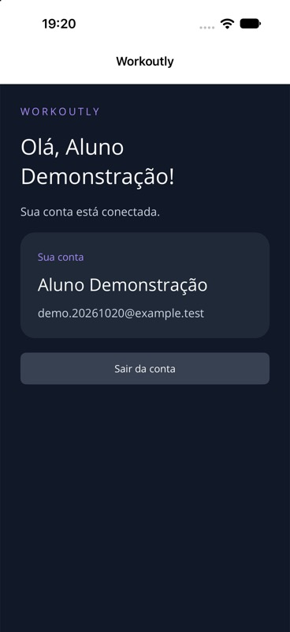

# Verificação de conta e acesso

Data: 20/10/2026. Branch: desenvolvimento/autenticacao. Marco: v0.3.0-contas.

## Testes automatizados

SDK .NET 10.0.401, MySQL 9.6.0 real e MySqlConnector 2.6.2. Resultado final: **12 testes aprovados, zero falhas e zero ignorados**. A execução mais recente usa contas MySQL restritas com senha e TLS, limitadas a bancos aleatórios. Bancos e usuários criados pelos testes são removidos ao final.

O primeiro teste de conta falhou com HTTP 404 antes da implementação. Uma falha posterior de conversão de Guid foi identificada pelo teste e corrigida antes da validação final.

Cobertura: liveness, readiness, migrações reaplicáveis, persistência; validação de nome/e-mail/senha; cadastro; login incorreto e correto; e-mail duplicado sem distinguir maiúsculas; perfil da própria conta; token adulterado; expiração; logout e revogação; restauração em outra instância da API; duas contas distintas; limite de tentativas.

```sh
python3 scripts/test-native-mysql.py
```

## Aplicativo

| Verificação | Evidência |
| --- | --- |
| Build iOS | Debug net10.0-ios, iossimulator-arm64, zero avisos e erros. |
| Build Android | Debug net10.0-android com JDK 21, zero avisos e erros. |
| Cadastro pelo app | Conta fictícia criada pelo formulário e exibida no perfil; HTTP 201 observado na API. |
| SecureStorage | Aplicativo encerrado e iniciado novamente; perfil recuperado sem nova senha, após GET /auth/me. |
| Logout | Retorno à tela de acesso; revogação no servidor também comprovada no teste HTTP. |
| Senha incorreta | Mensagem E-mail ou senha inválidos; os campos permaneceram preenchidos. |
| Novo login | Conta exibida novamente com a senha correta, sem recriar o usuário. |
| Falha de rede | Endereço temporário localhost:1 resultou em mensagem de conexão e preservação dos campos; retorno ao endereço correto permitiu entrar. |
| Reinício do ambiente local | MySQL e API reiniciados com dados .local/ preservados; conta continuou acessível. |

Ambiente visual: iPhone 18 Pro, iOS 27.0 Simulator. Instalação, lançamento, captura e reinício por XcodeBuildMCP. Interações de formulário pelo Device Hub via CUA: o tap por coordenadas do outro controle não alterou a tela, então foi usada a ação de acessibilidade dos controles nativos.



## Limites

Não foram testados execução Android, Windows, telefones físicos ou build Release. O cenário de tela utilizou HTTP apenas no loopback em Debug; a conexão entre API e MySQL foi posteriormente reiniciada com TLS. Não há evidência de usabilidade com participantes, nem fichas ou exercícios implementados. AUTH-02 cobre somente identidade/perfil nesta etapa; a autorização do domínio continua pendente.

Não foram alterados os documentos acadêmicos enviados ao professor. Senhas, .env, tokens e dados .local/ não fazem parte do Git. A imagem contém somente dados fictícios de teste.
