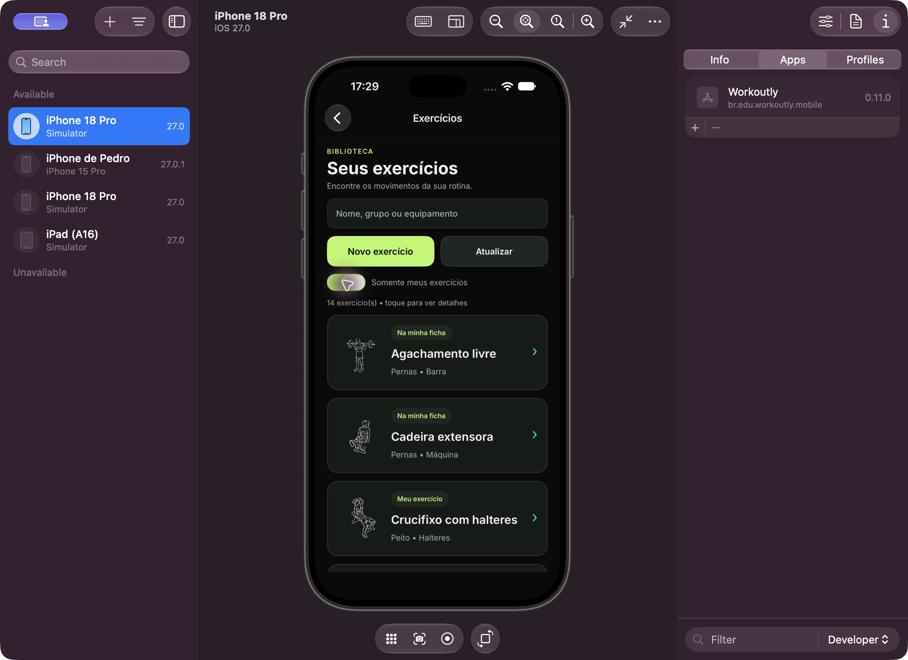
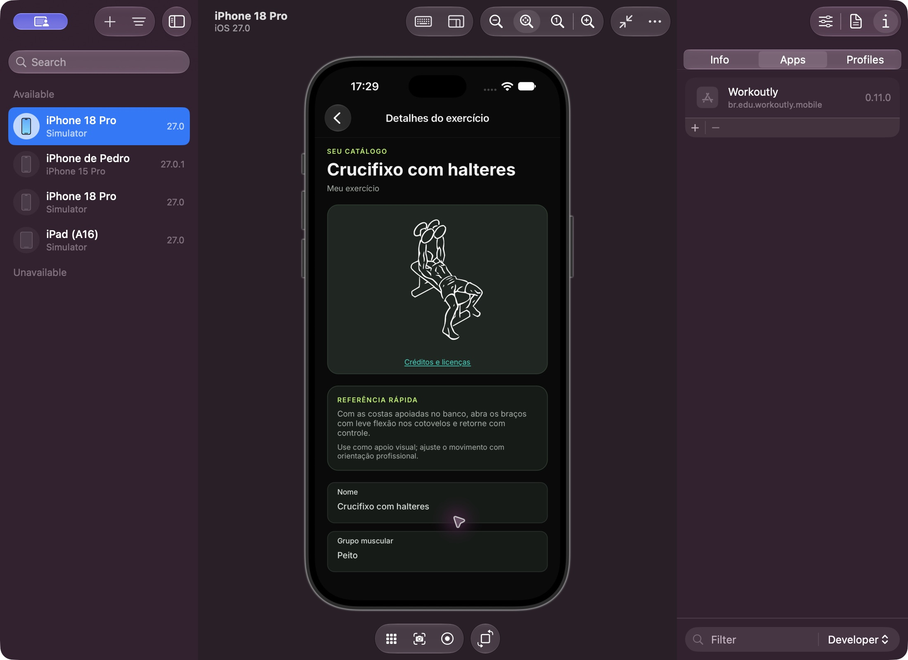

# Catálogo, filtro das fichas e imagens — 21/10/2026

## Correção e decisão

O filtro anterior usava `!IsShared` e, portanto, confundia exercícios cadastrados pela conta com os movimentos de suas fichas. A API agora informa `isOwned` e `isInPlan`; o app filtra pela união dessas condições. O catálogo também inclui as cópias dos exercícios privados disponibilizados nas revisões atuais das fichas ativas do aluno. Não expõe o restante do catálogo privado do professor. O mesmo ID em várias fichas aparece uma vez; registros próprios e prescritos com IDs diferentes permanecem separados, mesmo quando têm o mesmo nome.

O catálogo compartilhado passou de dez para 30 movimentos na migração 008, com inserções idempotentes e esquema versão 8. Os dados existentes do Pedro foram preservados. Aluno: 34 registros no catálogo completo, 14 no filtro (12 IDs das fichas e dois exercícios próprios). Professor: 32 registros disponíveis (30 compartilhados e dois próprios).

Foram adicionadas 20 ilustrações SVG locais, correspondentes aos movimentos cadastrados. Lista, seletor e detalhes apresentam imagens. Os nomes exatos dos novos movimentos também identificam os exemplos privados já cadastrados. Cadastros desconhecidos recebem apenas um ícone genérico, sem instrução inferida. A atribuição saiu do conteúdo principal dos detalhes e permanece completa em **Créditos e licenças**, acessível localmente. Fontes e licenças estão em THIRD-PARTY-NOTICES.md e nos recursos Raw.

## Verificação

- Regressão reproduzida antes da correção: exercícios próprios e da ficha ausentes dos indicadores usados pelo filtro.
- Regressão corrigida: teste HTTP com aluno, professor e outra conta; cobertura de exercícios compartilhados, próprios, prescritos, privados não prescritos, itens repetidos, revisão e exclusão de ficha.
- Suíte HTTP em MySQL real isolado: **34 testes aprovados, zero falhas e zero ignorados**.
- API local reiniciada com MySQL nativo; migração aplicada. Leitura das contas Pedro confirmou que todos os 12 IDs das três fichas estão no filtro e podem ser consultados nos detalhes.
- Os 31 SVGs (30 movimentos e um ícone genérico) foram analisados como XML válido. Recursos PNG rasterizados presentes e não vazios para todos os registros dos dois catálogos. Folha das 30 ilustrações inspecionada visualmente.
- Build iOS com SDK `/Users/pedrobaldi/.dotnet/dotnet`: **zero erros e zero avisos**. Comando: `dotnet build src/Workoutly.Mobile/Workoutly.Mobile.csproj -f net10.0-ios -p:RuntimeIdentifier=iossimulator-arm64 --no-restore`. A tentativa inicial no sandbox não encerrou; foi cancelada e repetida com acesso às ferramentas Apple, concluindo em 6,86 segundos.
- Atualização instalada sobre o app existente, bundle `br.edu.workoutly.mobile`, no iPhone 18 Pro / iOS 27.0, simulador `D622BB9C-63E5-4769-B571-4733628179EF`. Sessão Pedro aluno recuperada.
- Na interface: catálogo completo com 34 registros; ativação do filtro mostrou 14, incluindo agachamento, cadeira extensora e crucifixo. Miniaturas visíveis. Detalhes de crucifixo exibiram a ilustração e a dica, sem o nome do criador no conteúdo principal. A página local de créditos abriu corretamente. App deixado no filtro ativo.
- A interação por XcodeBuildMCP não alterou a tela; a navegação foi concluída pelo Device Hub com a ferramenta de interface nativa.

Android, aparelho físico e a interface do professor não foram revalidados neste incremento. O isolamento e os contratos dos dois perfis foram verificados por HTTP.

