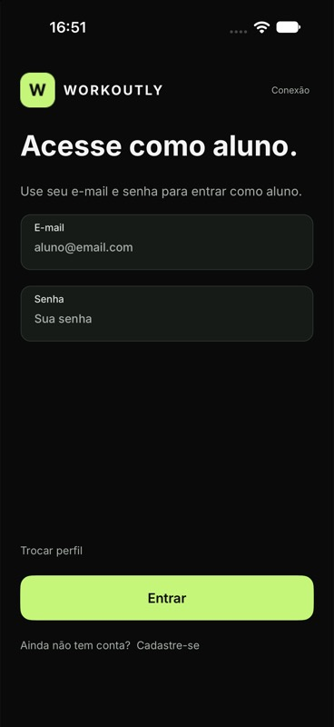

# Recuperação da execução iOS — 21/10/2026

Base: commit 61adf37, com correção local nas referências de imagens.

O simulador D622BB9C-63E5-4769-B571-4733628179EF (iPhone 18 Pro, iOS 27.0) executava o app, mas o Device Hub permanecia em “Connecting display…”. Uma captura direta confirmou a tela inicial. Fechar e reabrir o Device Hub e iniciar novamente o mesmo simulador recuperou a visualização, sem apagar o dispositivo ou seus dados.

A API estava desligada. Iniciada com `python3 scripts/dev-native.py`; compilação da API sem erros/avisos, migração aplicada e `/health/ready` retornou `ready`, banco `ready`, esquema 7. O helper foi mantido em execução.

Corrigidas referências do avatar e das dez ilustrações de exercícios para `.png`: os arquivos-fonte continuam SVG, mas os recursos produzidos pelo Resizetizer são PNG. Antes, o log indicava `figma_avatar.svg` ausente. O log da nova abertura não apresentou esse erro do avatar; as ilustrações de exercícios ainda exigem conferência nas respectivas telas.

Compilação: `/Users/pedrobaldi/.dotnet/dotnet build src/Workoutly.Mobile/Workoutly.Mobile.csproj -f net10.0-ios -p:RuntimeIdentifier=iossimulator-arm64 --no-restore`. Resultado: zero erros e zero avisos. Instalado e aberto no mesmo simulador, com tela de seleção de perfil e navegação até acesso do aluno confirmadas visualmente. Endereço configurado na interface: `http://localhost:5080/`.

O aviso de conexão com a IDE em `127.0.0.1:10000` persistiu no lançamento sem depurador, mas não impediu a abertura. Outros avisos do runtime/simulador permanecem no log. Não foram validados login, cadastro, fluxo completo de treinos, Android ou aparelho físico nesta correção.

Para repetir: iniciar `Executar-local.command` (apenas uma instância) e executar Workoutly.Mobile no Rider com o iPhone simulado selecionado. Caso a janela fique em “Connecting display…”, fechar o Device Hub com Command+Q, reabrir pelo Xcode e iniciar o mesmo simulador. Não usar Erase All Content and Settings.
