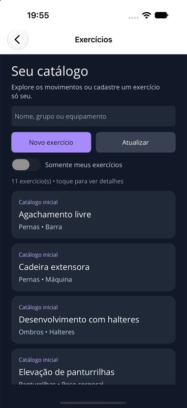
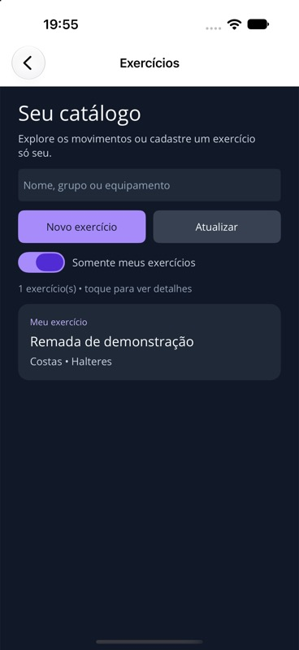
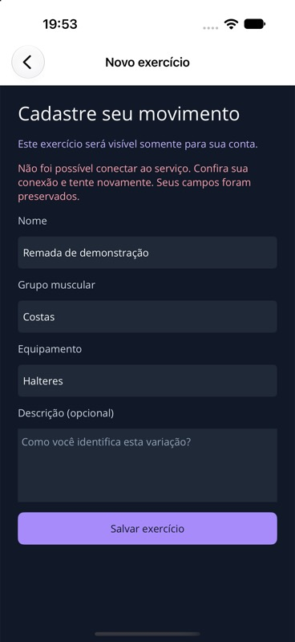

# Verificação do catálogo de exercícios

Data: 20/10/2026. Branch: desenvolvimento/exercicios. Marco: v0.4.0-exercicios.

## Testes HTTP e MySQL

`python3 scripts/test-native-mysql.py`: **15 aprovados, zero falhas, zero ignorados**, usando MySQL 9.6.0 real e SDK .NET 10.0.401. A execução cria bancos e usuários temporários restritos; estes são removidos ao final, sem usar os dados da demonstração.

Três testes novos verificam: catálogo com login e dez exercícios sem duplicação ao reaplicar migrações; criação privada e recuperação em outra instância da API; outra conta não lista nem consulta o ID privado; campos adicionais de propriedade não alteram o dono autenticado; leitura/criação anônimas são recusadas; limites de nome/grupo/equipamento/descrição; rejeição sem adicionar registros inválidos. Os doze testes anteriores de saúde, migração e conta continuam passando.

Os ciclos começaram com falhas observadas: GET /exercises retornou 404 antes da implementação; POST retornou 405 antes do cadastro; um nome de um caractere foi aceito antes da validação. Cada caso foi implementado e a suíte passou em seguida. O helper também verificou Kestrel com esquema pendente (503), aplicação das migrações (200) e prontidão após reiniciar a API (200).

## Aplicativo

Ambiente: iPhone 18 Pro, iOS 27.0 Simulator, app 0.4.0. Instalação, lançamento, reinício e capturas por XcodeBuildMCP; interação com controles nativos do Device Hub por CUA. Conta e exercício demonstrativos fictícios.

| Cenário observado | Resultado |
| --- | --- |
| Conta conectada → Explorar exercícios | Dez itens iniciais, com nome, grupo e equipamento. |
| Busca TRICEPS | Encontrou Tríceps na polia, ignorando acento e maiúsculas. |
| Seleção de exercício inicial | Abriu detalhes do exercício, sem botão de salvar/editar. |
| Nome A e demais campos preenchidos | Validação retornou mensagem de nome entre 2 e 120; campos mantidos. |
| Serviço local interrompido durante o formulário | Falha de conexão exibida; nome Remada de demonstração, grupo Costas e equipamento Halteres preservados. |
| Serviço reiniciado e nova tentativa | Retornou à lista com onze itens, incluindo o registro privado. |
| Filtro Somente meus exercícios | Mostrou somente Remada de demonstração, identificado como Meu exercício. |
| App encerrado, versão final reinstalada e reaberta | Sessão recuperada; catálogo consultado novamente; exercício privado e detalhes recuperados. |
| Busca sem correspondência | Estado vazio com instrução para ajustar a busca ou cadastrar um exercício. |
| Ajuste visual final | Campo de busca trocado por Entry nativo com cores coerentes; busca repetida na versão final. |

Compilações finais: iOS Debug net10.0-ios/iossimulator-arm64 e Android Debug net10.0-android com JDK 21; ambas com zero avisos e zero erros. API também compilou sem avisos ou erros.

## Demonstração reproduzível

Inicie `Executar-local.command`, abra o projeto MAUI no simulador, entre ou crie uma conta fictícia, abra Explorar exercícios, busque um movimento, consulte detalhes, limpe a busca e cadastre um exercício. Ative Somente meus exercícios, feche e reabra o app e consulte o registro novamente. O ambiente local preserva o banco em .local/, fora do Git. Se o helper já estiver aberto, use essa instância.

## Limites

Execução Android, Windows, telefones físicos e Release não foram verificados neste incremento. Não houve avaliação com participantes. Fichas, execução de treinos e indicadores permanecem pendentes; selecionar um item nesta versão abre detalhes, sem montar uma ficha. Não há edição/exclusão de exercícios ou sincronização offline.

Os documentos acadêmicos e suas cópias de texto na pasta superior mantiveram os quatro hashes SHA-256 anteriores. Nenhuma senha, token, .env, banco .local/ ou artefato de compilação integra esta entrega versionada.
