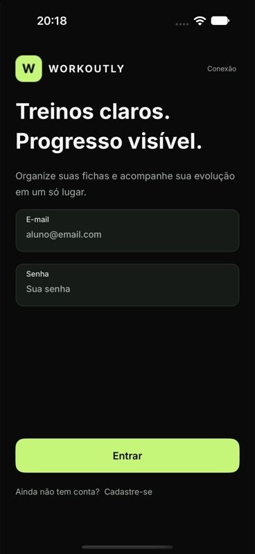
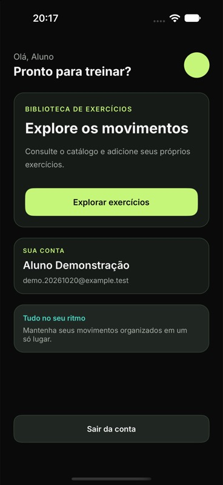
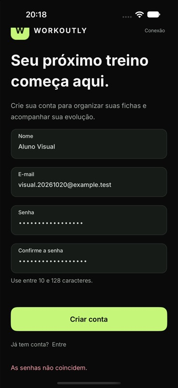
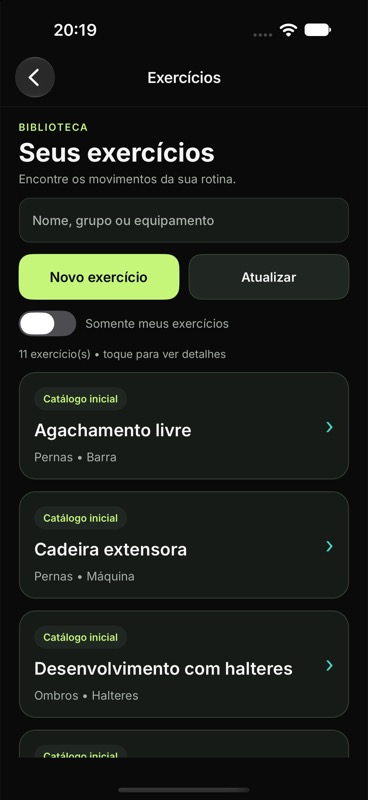
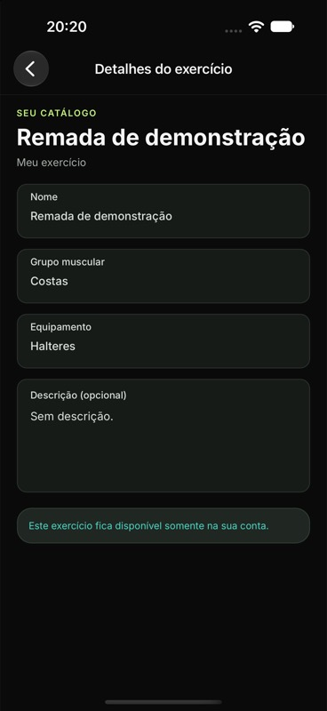
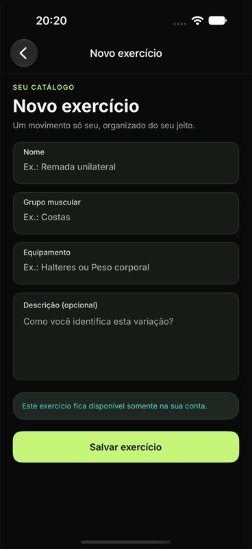

# Verificação da identidade visual

Data: 20/10/2026. Branch: desenvolvimento/identidade-visual. Marco: v0.5.0-identidade-visual.

Referência: Figma 8HCGErKrHaFX0yCqdbu2Iw, frames Entrar (5:2), Início (5:3) e Minhas fichas (5:4). Contextos detalhados e imagens consultados antes das alterações. A marca 6:3 e o avatar 8:4 foram baixados sem alterações; arquivos e hashes registrados em ../design/manifest.json.

## Comparação visual

Conferida no iPhone 18 Pro, iOS 27.0 Simulator, MAUI 10.0.110. Capturas por XcodeBuildMCP e interação com controles pelo Device Hub/CUA. A implementação foi comparada às referências locais docs/design/figma-entrar.png, figma-inicio.png e figma-fichas.png.

Aplicados: fundo #0A0A0A; superfícies #161B17/#202722; destaque #C5F67A e turquesa #4BD9C7; quatro pesos de Inter; contornos, raios, hierarquia de títulos, campos com rótulo interno e ações primárias/secundárias. A marca ocupa 42 × 42 no acesso e o avatar 46 × 46 no início. SVG e PNG locais possuem conteúdo, dimensões e referências de uso conferidos. A interface usa controles nativos, com diferenças de barras de sistema e área segura em relação ao frame de referência.

O início usa conta e ações reais do estágio atual. Os números, fichas e treinos ilustrativos do protótipo não foram transformados em dados simulados no produto. Catálogo e formulários foram adaptados a partir dos padrões dos frames, pois não havia telas específicas dessas funções no Figma consultado.

## Fluxos observados

| Cenário | Resultado |
| --- | --- |
| Atualização e abertura do app | Sessão da conta fictícia recuperada e novo início exibido. |
| Logout | Retorno ao novo acesso, com marca, título e campos no padrão do Figma. |
| Alternância para cadastro | Nome, confirmação, orientação de senha e ação Criar conta disponíveis com rolagem. |
| Confirmação divergente | Mensagem As senhas não coincidem, mantendo os campos preenchidos. |
| Login incorreto e correto | Erro preservou os campos; senha correta abriu o início da conta existente. |
| Catálogo e busca TRICEPS | Lista consultada pela API; busca encontrou Tríceps na polia. |
| Somente meus exercícios | Registro privado anterior recuperado e detalhes abertos. |
| Novo exercício | Nome Remada visual, grupo Costas, equipamento Halteres e descrição Registro de teste visual. preenchidos e salvos. |
| Consulta após salvar | Lista recarregada; novo exercício e descrição recuperados nos detalhes, sem botão de edição. |
| Voltar ao início | Navegação retornou ao início autenticado, sem perder a conta. |

Os dados usados são fictícios e ficam no banco local ignorado pelo Git. A comparação de senha divergente não criou uma nova conta. O cadastro de exercício adicionou somente um registro demonstrativo privado.

## Compilação e regressão

- iOS Debug, net10.0-ios / iossimulator-arm64: zero avisos e zero erros.
- Android Debug, net10.0-android, JDK 21: zero avisos e zero erros.
- `python3 scripts/test-native-mysql.py`: **15 aprovados, zero falhas e zero ignorados** em MySQL 9.6.0 temporário real. Fluxos anteriores de conta, privacidade, catálogo e persistência permaneceram passando.
- API compilou sem avisos ou erros ao iniciar o ambiente local. Nenhuma regra, contrato, migração ou tabela da API foi alterada neste incremento.

## Capturas

## Limites

Android foi compilado, mas não executado neste incremento. Não foram validados Windows, telefones físicos, Release ou distribuição em loja. O cadastro exige rolagem em áreas úteis menores; o iPhone foi verificado em retrato. Não foram realizados testes com participantes. Fichas, treino e histórico continuam pendentes, incluindo sua futura navegação inferior. Os documentos acadêmicos da pasta superior mantiveram seus hashes anteriores; o arquivo Figma não foi editado.
