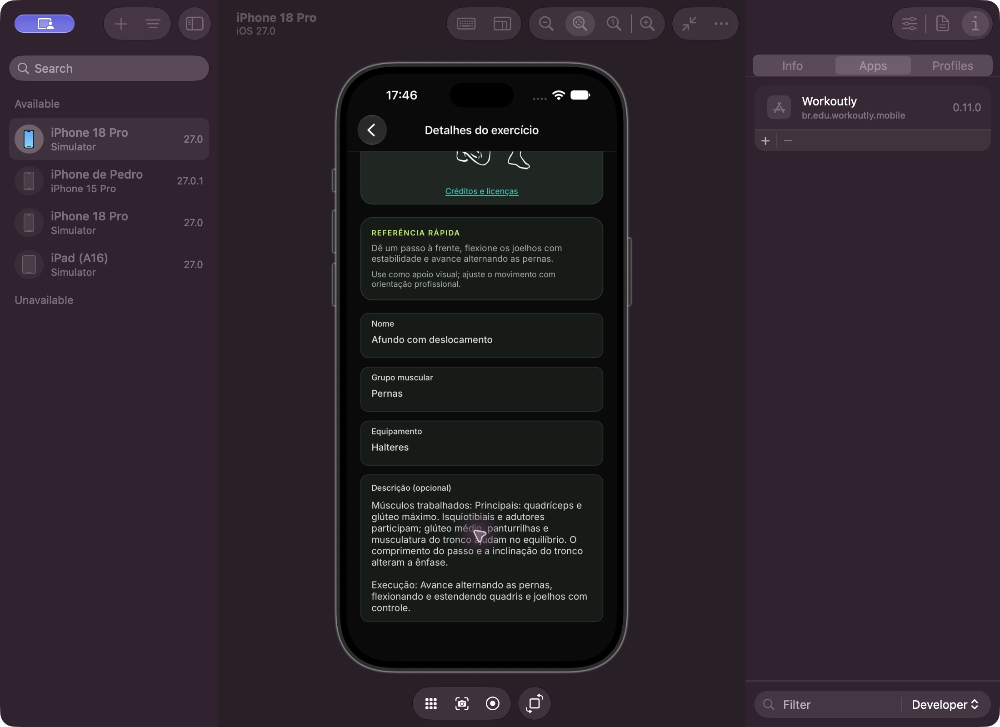

# Descrições musculares e verificações — 21/10/2026

## Resultado

Revisados os 36 registros existentes no MySQL local: 30 compartilhados e seis privados. As descrições incluem músculos principais, auxiliares e estabilizadores conforme a identificação do movimento. As 30 descrições compartilhadas são versionadas na migração 009, com esquema atual 9. Pesquisa, critérios, fontes por exercício e ressalvas estão em [Revisão muscular](../revisao-musculos-exercicios.md) e [catálogo estruturado](../catalogo-musculos.json).

As seis descrições privadas foram complementadas preservando observações anteriores. Os dois cadastros de remada sem variação definida recebem informação condicional, explicitando a limitação. Nenhuma pegada, apoio ou trajetória foi inventada. O grupo da rosca martelo foi ampliado para braços e antebraços. Exercícios de nomes iguais em contas distintas mantiveram IDs e propriedade.

## Evidências e limites

- Antes: 11 registros sem descrição, dos quais dez compartilhados e um privado. Os outros textos traziam instruções ou notas de demonstração, sem a identificação dos músculos.
- Backup local dos catálogos, fichas atuais, sessões e itens de revisões antigas em `.local/revisao-musculos/`, ignorado pelo Git, com arquivos de dados restritos à conta do sistema.
- **34 testes HTTP aprovados, zero falhas e zero ignorados**, usando MySQL real em banco temporário isolado. A verificação do catálogo testa as descrições após reaplicar migrações, o limite de 1000 caracteres e exemplos anatômicos de agachamento, rosca martelo e panturrilha sentada.
- API recompilada sem erros ou avisos e reiniciada no mesmo banco nativo. `/health/ready`: `ready`, `schemaVersion: 9`.
- **36 registros únicos** com identificação muscular. **158 descrições visíveis** conferidas através dos catálogos das cinco contas existentes; cada texto dentro do limite de 1000 caracteres.
- **Sete fichas ativas** receberam novas revisões. Ordem, IDs dos exercícios, séries e repetições permaneceram iguais. Todas as fichas atuais conferidas têm as descrições musculares; professor e respectivos alunos recuperam os mesmos dados.
- **21 sessões existentes** comparadas integralmente pela API antes/depois: nenhum campo alterado. Isso inclui cargas, duração, observações, séries, volume e revisão executada.
- **45 itens de revisões antigas** comparados integralmente: preservados, inclusive os que não estão associados a sessões.
- Filtro de exercícios próprios inclui todos os IDs das fichas atuais de cada aluno, sem expor o restante do catálogo privado de outra conta. Vínculos existentes preservados.
- Segunda execução da atualização local: **zero descrições privadas alteradas e zero revisões novas**. A preparação é idempotente.
- JSON de pesquisa: 30 IDs e nomes distintos, referências válidas dentro do catálogo de fontes, textos dentro do limite e sem caracteres de outros alfabetos inseridos por engano. `git diff --check` passou.
- No iPhone 18 Pro / iOS 27.0, ao voltar ao catálogo e reabrir Afundo com deslocamento, a descrição atualizada apareceu integralmente, com músculos e execução. Texto legível no formulário de detalhes já existente. Não foi necessária nova compilação mobile, pois a alteração usa o campo de descrição já consumido pela interface.

O campo de descrição de uma sessão antiga continua refletindo sua revisão original; os textos atuais estão no catálogo e nas novas revisões. Nomes genéricos de remada ainda dependem de identificação da variante pelo responsável. A pesquisa identifica participação muscular, sem prometer isolamento, hipertrofia ou adequação individual. Android e aparelho físico não foram revalidados nesta revisão de conteúdo.

