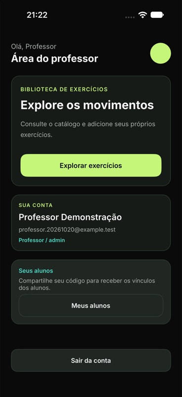
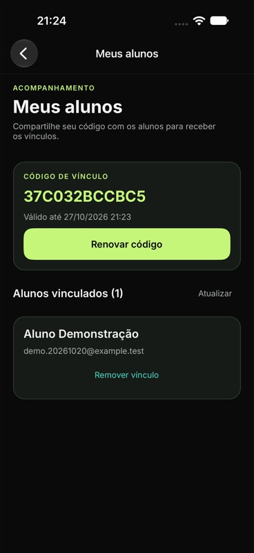

# Verificação de perfis e vínculos

Registro: 21/10/2026. Branch: desenvolvimento/perfis-e-vinculos. Marco: v0.6.0-perfis.

## Contratos, comando administrativo e banco

Comando executado: `python3 scripts/test-native-mysql.py`. Resultado: **18 aprovados, zero falhas e zero ignorados**, em MySQL 9.6.0 real, SDK .NET 10.0.401. Instâncias, bancos e usuários temporários foram removidos ao final; os dados da demonstração não foram usados pela suíte.

Três testes novos em RoleTests.cs verificam o comportamento pela API e pelo comando público --create-teacher:

- Cadastro público sempre cria student, mesmo recebendo role=teacher e isAdmin=true; aluno recebe 403 nas rotas do professor.
- Comando administrativo cria teacher; login e perfil retornam esse papel. Tentativa de criar professor com e-mail de aluno existente falha sem promover a conta ou trocar suas credenciais. A saída do comando não contém a senha.
- Migração reaplicada preserva o papel de professor; acesso anônimo é recusado.
- Aluno inicia a associação por código e IDs enviados no corpo não mudam quem será vinculado. Professor não pode executar a operação de aluno.
- Professor vê somente seus alunos; outro professor não consegue consultar detalhes nem remover o vínculo alheio, recebendo 404.
- Mesmo vínculo repetido não duplica a relação; trocar professor sem remover o atual retorna 409 e preserva o anterior.
- Renovar código invalida o anterior para novos vínculos e mantém o vínculo existente. Aluno pode sair e se vincular a outro professor. Professor pode remover vínculo próprio, sem excluir conta.
- Vínculo é recuperado por outra instância da API. Convite expirado não é oferecido nem aceito, mesmo após um novo login com o relógio avançado em oito dias.

Os quinze testes anteriores continuam passando. O primeiro ciclo de papel falhou porque role ainda não existia na resposta; o primeiro ciclo de vínculo falhou com 404 antes da implementação. O helper também confirmou esquema pendente (503), migração (200) e persistência de prontidão após reiniciar a API (200).

## Aplicativo e ambiente local

iPhone 18 Pro, iOS 27.0 Simulator; MAUI 10.0.110, app 0.6.0. Instalação, lançamento, reinício e capturas por XcodeBuildMCP; interação pelo Device Hub/CUA. Dados fictícios de demonstração.

| Cenário | Resultado observado |
| --- | --- |
| Atualização do banco local | Readiness retornou ready, database=ready e schemaVersion=4. Dados existentes preservados. |
| Criação administrativa | Helper create-teacher --native criou a conta fictícia Professor Demonstração. O socket é obtido de metadados .local/, sem persistir outra cópia da senha de conexão. |
| Login de professor | Exibiu Área do professor, Professor / admin e Meus alunos. |
| Lista inicial | Nenhum aluno vinculado; geração de código disponível. |
| Geração de convite | Código de 12 caracteres e validade de sete dias apresentados. |
| Conta anterior de aluno | Login de Aluno Demonstração continuou funcionando, agora identificado como Aluno. |
| Confirmação pelo aluno | Código informado; diálogo explicou o compartilhamento de nome/e-mail; confirmação exibiu o professor vinculado. |
| Retorno à conta do professor | A lista passou a mostrar Aluno Demonstração, com nome/e-mail e ação de remover vínculo. |
| Reinício do app | Sessão de professor recuperada; perfil Professor / admin e entrada Meus alunos permaneceram corretos. |

Compilações iOS Debug net10.0-ios/iossimulator-arm64 e Android Debug net10.0-android com JDK 21: ambas com zero avisos e zero erros. Scripts Python passaram na compilação de sintaxe, e o helper de criação foi executado no ambiente nativo real. Remoção, troca e expiração foram verificadas nos testes HTTP; não foram repetidas manualmente na interface.

## Limites

Não foram executados Android, Windows, telefone físico, Release ou avaliação com participantes. A criação com Docker está documentada, mas foi validada somente pelo caminho nativo deste Mac. Não há montagem de fichas nem consulta de treinos de alunos nesta etapa: estão previstas em FICHA-01 e HIST-01, usando o vínculo implementado. O professor/admin não possui acesso global às contas ou aos exercícios privados dos alunos.

Nenhum documento acadêmico da pasta superior foi alterado. Senhas, tokens, .env, banco local, metadados de execução e artefatos de compilação permanecem fora do Git. As capturas contêm somente dados fictícios.
